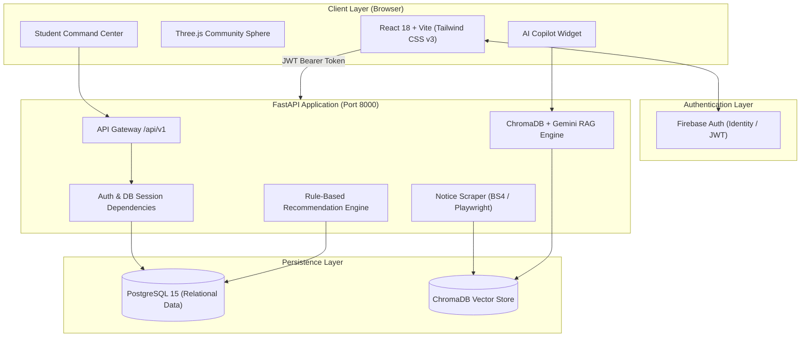
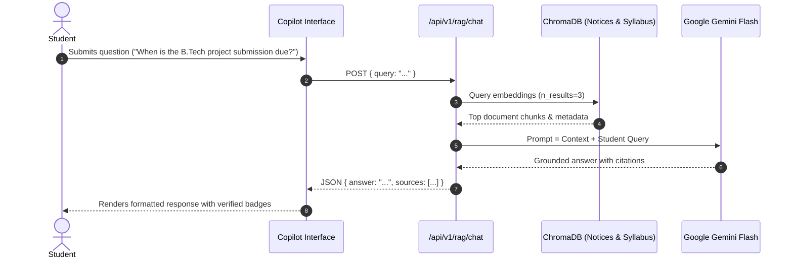

# 🏛️ CampusSync Architecture & System Design

CampusSync is an intelligent, unified campus management platform designed with an editorial **"Cinematic Academic"** aesthetic and powered by a high-throughput **FastAPI** backend and **Gemini RAG (Retrieval-Augmented Generation)** intelligence engine.

---

## 1. System Architecture Diagram

---

## 2. Technology Stack Breakdown

| Tier | Technologies | Primary Purpose |
| :--- | :--- | :--- |
| **Frontend** | React 18, Vite, React Router v6 | High-speed single-page application |
| **Styling** | Tailwind CSS v3, Glassmorphism, Google Fonts (Manrope, Instrument Serif) | Cinematic Academic editorial aesthetic |
| **3D & Canvas** | Three.js WebGL Canvas | Interactive community connection visualizer |
| **Backend** | FastAPI (Python 3.10+), Uvicorn | Async REST API services & dependency injection |
| **ORM & Database** | SQLAlchemy, Alembic, PostgreSQL | Relational modeling for academic & social records |
| **Vector Database** | ChromaDB | Local embedding indexing & similarity retrieval |
| **LLM Provider** | Google Gemini 1.5 / 2.0 Flash | Grounded query answering with source attribution |
| **Authentication** | Firebase Authentication + JWT Verification | Secure student identity management |

---

## 3. RAG Pipeline Architecture

---

## 4. REST API Endpoint Catalog

### System & Health
- `GET /health` — Check backend runtime status and database connectivity.

### Student Authentication & Profile
- `POST /api/v1/auth/register` — Register student account in database.
- `POST /api/v1/auth/login` — Authenticate student credentials and issue JWT.
- `GET /api/v1/profile/` — Fetch authenticated student profile and academic standing.
- `PUT /api/v1/profile/` — Update student department, semester, student ID, and interests.

### Academic Operations
- `GET /api/v1/dashboard/summary` — Key student metrics (GPA, attendance, pending tasks).
- `GET /api/v1/courses/` — List enrolled courses and faculty details.
- `GET /api/v1/assignments/` — Retrieve course assignments and deadlines.
- `GET /api/v1/notices/` — Verified notices with category filters and search.

### Social & Recommendations
- `GET /api/v1/events/` — Campus technical fests, workshops, and dates.
- `GET /api/v1/events/clubs` — Student clubs and focus area directories.
- `GET /api/v1/recommendations/` — Rule-based personalized recommendations & urgent alerts.
- `GET /api/v1/community/` — Community feed discussions and peer queries.
- `POST /api/v1/community/` — Publish sanitized student community post (XSS protected).
- `POST /api/v1/community/{id}/like` — Upvote community discussion.
- `GET /api/v1/saved/` — User's bookmarked notices, events, and posts.
- `POST /api/v1/saved/` — Bookmark or remove saved item.

### AI & Data Pipeline
- `POST /api/v1/rag/chat` — Context-grounded campus AI copilot query.
- `POST /api/v1/scraper/run` — Trigger automated college portal scraping run.
